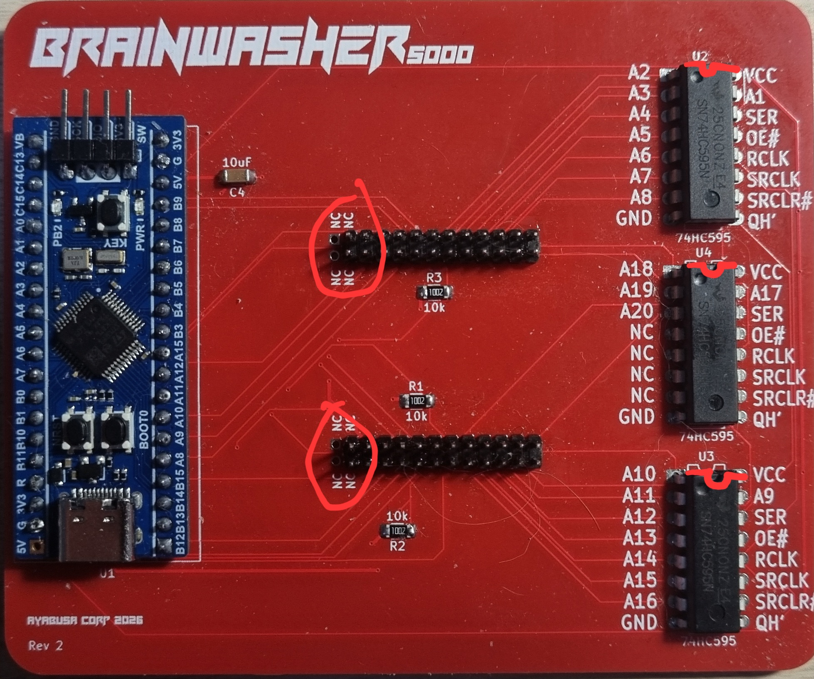
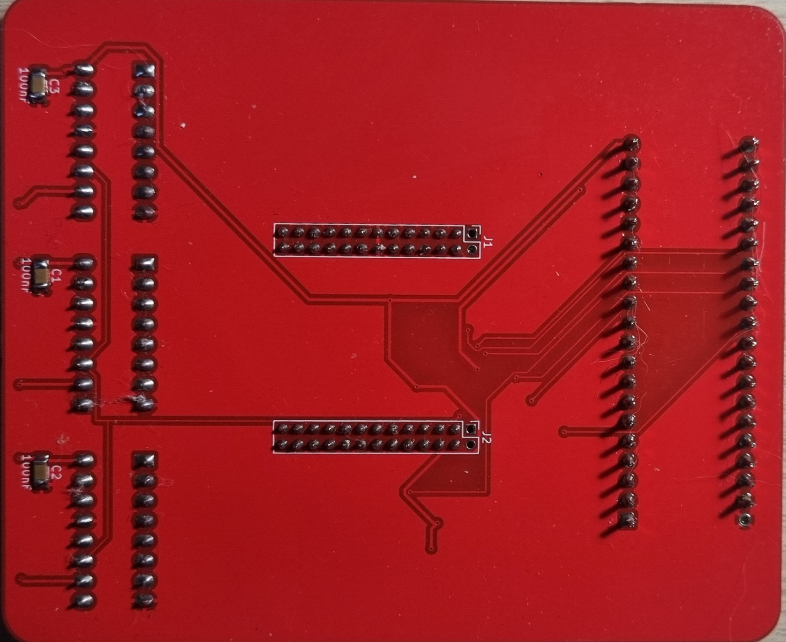
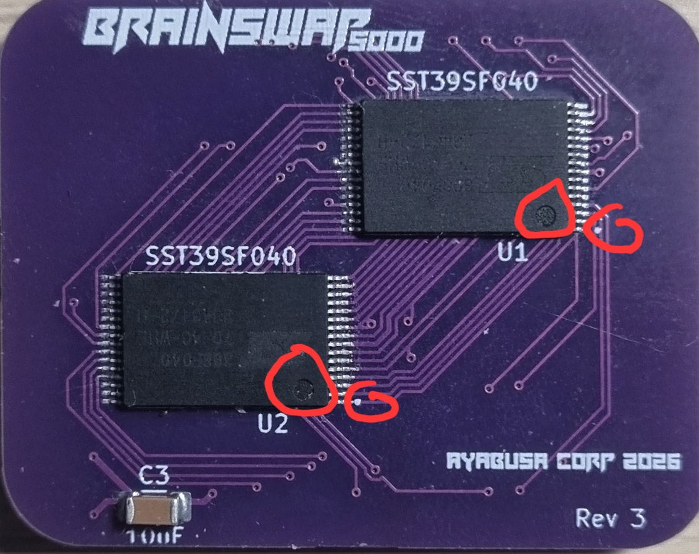
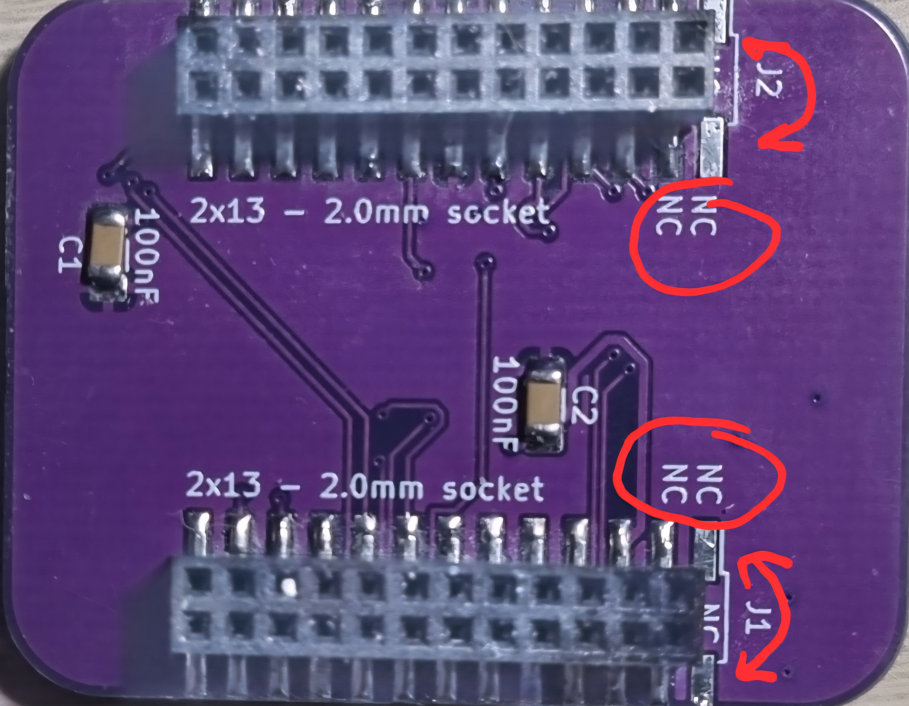
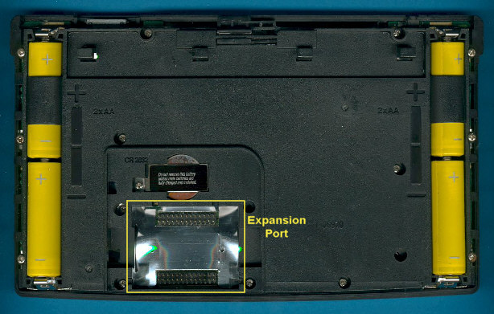

# TI-92 Brainwasher
Welcome to the Brainwasher repo ! Here you'll find everything you need, to create and use a custom ROM module for your TI-92.

## Why this project ?
This project aims to recreate the original ROM module from the TI-92 and add the ability to change the OS on it. Indeed the original ROM module is readonly (unless you want to blast UV on it...), so once you bought the calc, you can't ever update :( 

Another use case is repairability, if the module was lost or damaged, the calc became useless. 

But not anymore with this project you can recreate your own and tweak the OS to your liking !

## Great, how do I get this stuff
This project is centered around two boards, a module board (Brainswap) containing 2 EEPROM that will go into the calc. And a programmer (Brainwasher) that will enable you to change the OS of the module.

There are multiple steps needed, you'll need to build the hardware, flash the firmware and finally use the PC software app.

### Hardware
First you'll need to gather the following components, AliExpress is your friend:
- `1x STM32F103C8T6 Bluepill` board, I recommend the `Blupill plus` from WeAct Studio
- `1x ST-Link`, these come in different form factor, there is often a bundle version containing one with the Bluepill
- `3x SN74HC595N` register shift
- `2x Male header 2.0mm with 2x13P or 2x12P or 2x11P`, there is 2 collumn not connected on each connector so buy what is the cheapest
- `2x SST39SF040 in TSOP32` EEPROM
- `2x SMD Female socket 2.0mm in 2x13P or 2x12P or 2x11P`
- `5x 100nF Capacitor in 1206 SMD`
- `2x 10µF Capacitor in 1206 SMD`
- `3x 10k Resistor in 1206 SMD`

On top of that you'll need to order the two custom PCB (more info in `pcb/README.txt`) using an online service like [PCBWay](https://www.pcbway.com/)

Once you have everything, solder everything according to the silkscreen markings on the PCB and using reference images. Be really carefull at the orientation of the components.
- The Bluepill orientation is clearly indicated by the silkscreen.
- The 74HC595 orientation is indicated by the semi-circle on the silkscreen and present on the actual ICs.
- The SST39SF040 orientation is indicated by the little dot in the corner of the silkscreen, also present on the actual ICs.
- For the male/female connector, if you got a 2x11P or 2x12P, you'll need to place the pins to the opposite of the NC ones

#### Reference pictures

### Firmware
Once everything is assembled, you we'll need to program the Bluepill with the firmware located in the `firmware` directory you'll find more info in `firmware/README.txt`.

### Software
Then you'll be able to flash a ROM onto your custom module using the PC software, you can find more info in `software/README.txt`.

### Replacing the module
Once everything else is done you can put your module in the calc by opening it's back.

BE CAREFUL !!! REMOVE ALL THE BATTERIES FIRST !!!

### Box
There is also a purely cosmetic packaging I made, inspired by the original TI-92 Box. You can print it using the pdf in `box/box.pdf`

## License
There are different part in this project, and different Licenses, refer to the LICENSE.txt in each folder. If unsure contact me via Email at `contact [at] ayabusa (dot) dev`
