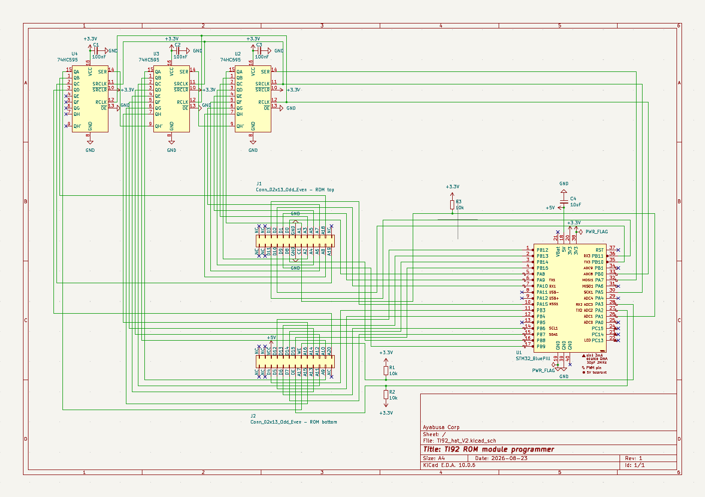
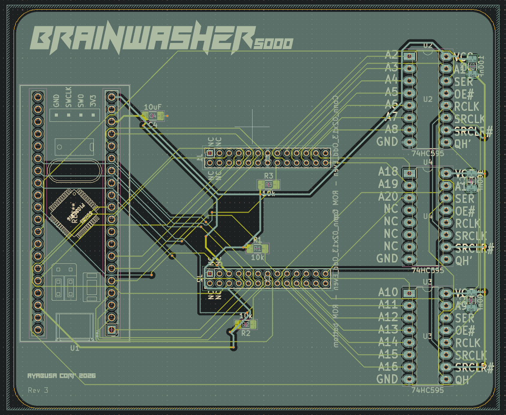

# Custom TI-92 Module PCB
This section of the repo contains the schematic and PCB for the two different boards. You can use the `.zip` files in the gerber directory to order them on different websites.

## How to edit
These files were created using KiCad 10.0, you can edit them using this software.

## License
This part of the repo is licensed under the CC BY-NC-SA 4.0 license, see more details in the LICENSE.txt file
