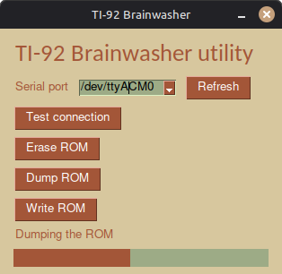

# Brainwasher PC software
This Python script is designed to communicate easly with the brainwasher board ;D

It provides a small GUI made with PySimpleGUI that let you
- Erase the ROM
- Dump the ROM
- Write to the ROM



## How to install
### Prebuilt binaries
If I'm nice enough, I'll have made some prebuilt binaries that you can download from the Release section of this repo

### Launch with python
To use this script, you need Python 3 installed, depending on your OS the python executable might be called `python` or `python3`
#### Unix like (Linux and maybe MacOS)
```bash
cd software
python3 -m venv venv
source venv/bin/activate
pip install -r requirements.txt
python3 brainwasher_connect.py
```

#### Micro$lop Window$
```bash
cd software
python -m venv venv
venv\Scripts\activate
pip install -r requirements.txt
python brainwasher_connect.py
```

## How to use
The software is pretty straight forward.

First select the serial port of the Brainwasher with the dropdown menu (after clicking refresh). If you are unsure about which one it is, try disconnecting/connecting and refreshing the list to see which port disappear/appear.

You can then choose to erase, write or dump the ROM by clicking the buttons and following instruction.

Don't be dumb, wait til the read/write operation finishes before unplugging the Brainwasher.

Have fun :D

## License
This part of the repo is Licensed under the Beerware License, see more info in LICENSE.txt
